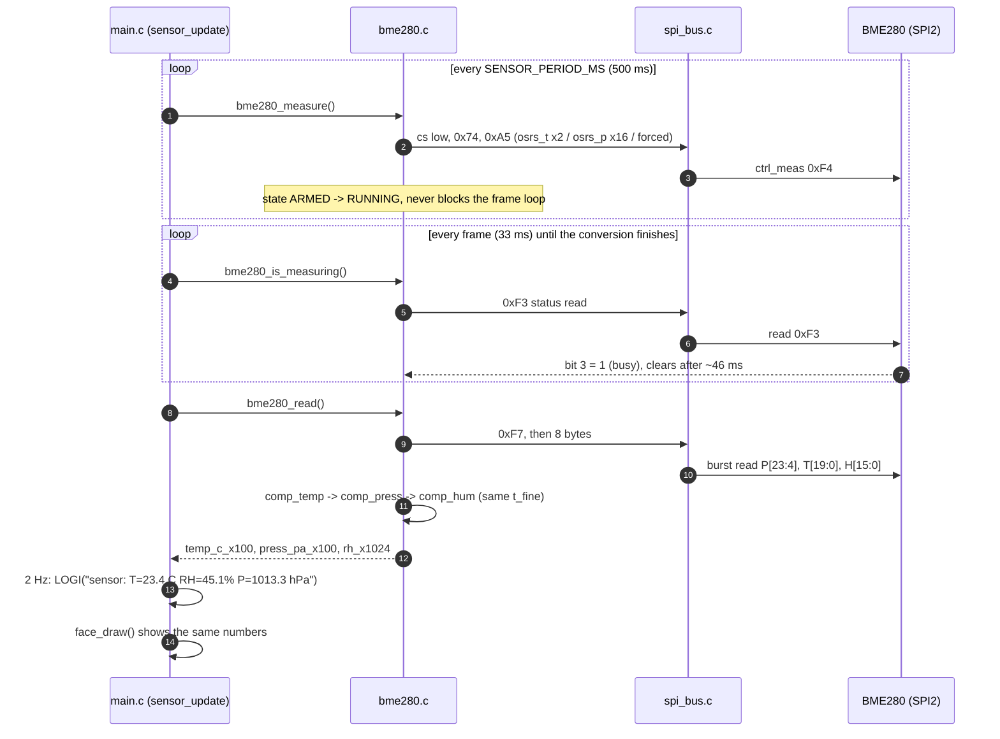

# STM32F401CEU6 "Retro Casio" Desk Clock

A desk clock built around three I2C peripherals sharing **I2C1 (PB8 =
SCL, PB9 = SDA @ 400 kHz)** plus one SPI sensor:

| Component | Driver | Bus | Address / pins | Role |
|---|---|---|---|---|
| SSD1306 128×32 OLED | `Core/Src/ssd1306.c` | I2C1 | `0x3C` | Displays the Casio-style clock face |
| DS1307 RTC | `Core/Src/ds1307.c` | I2C1 | `0x68` | Source of the current time |
| AT24C32 EEPROM | `Core/Src/at24.c` | I2C1 | `0x50` | Keeps a backup of the last trusted time |
| BME280 T/P/RH | `Core/Src/bme280.c` | SPI2 | PB13/14/15 + PB12 CS | Temperature, humidity, pressure line + log |

A USB-TTL adapter on **USART1 (PA9 TX / PA10 RX, 115200 8N1)** carries
the log (`Core/Src/ilog.c`). There are no buttons: the flow is fully
automatic and runs forever from `main()`.

All tuning knobs (bus speed, addresses, panel geometry, animation,
retry intervals) live in `Core/Inc/app_config.h`.

---

## 1. Clock flow (`ds1307.c` / `acquire_time()` in `main.c`)

The application never trusts the RTC blindly — it *acquires* a time
with a fallback chain, once per second:

1. **Try the RTC** — `ds1307_read()` reads BCD registers 0x00–0x07 via
   a register read (`i2c_bus_read_reg8`, repeated-start) and decodes
   them into a `ds1307_time_t` (bit 7 of seconds = oscillator halted).
2. **RTC answered, clock running** — that time is shown and becomes
   the *seed* (`s_seed` + `s_seed_ms`). If the RTC time is *older*
   than the firmware build stamp (`__DATE__`/`__TIME__`) and
   `RTC_SEED_FROM_BUILD_STAMP` is 1, the build stamp is re-written to
   the RTC (`ds1307_write()`) so a stale seed doesn't persist.
3. **RTC answered but oscillator halted** (coin cell dead/absent) —
   seed from the build stamp, else from the EEPROM backup; the seed is
   written to the DS1307 and also saved so the face keeps counting
   from `board_ms()` even if the write fails.
4. **RTC never answers / stopped answering** — first try the build
   stamp, then `backup_load()` from EEPROM; the last trusted time
   becomes the seed and `advance_time()` derives the displayed time
   from `board_ms()` elapsed since the seed. The face keeps ticking
   (with drift) instead of freezing.

The build stamp parser (`parse_build_stamp()`) computes the weekday
with Sakamoto's algorithm; `days_in_month()` handles month rollover
when deriving time from the seed.

## 2. EEPROM flow (`at24.c` + `backup_save()` / `backup_load()`)

Purpose: survive an RTC battery swap with a *plausible* time instead
of a bogus 2000-01-01.

- **Layout**: 8 bytes at `TIME_BACKUP_EEPROM_ADDR` (0x0000):
  `[magic 0xC5, hour, minute, second, day, date, month, year]`.
- **Save**: at most **one write per minute**, when the RTC reports
  `second == 0` and the minute changed (`s_last_backup_min`). This
  stays far below the AT24C32's ~1 M write-cycle budget.
- **Write path**: `at24_write()` splits the request across 32-byte
  pages and waits ~5 ms per write cycle; the 8-byte blob fits in one
  page anyway.
- **Read path**: `backup_load()` → `at24_read()` at 0x0000; anything
  without the magic byte is treated as "no backup" and rejected, and
  field values are sanity-clamped (`hour %= 24`, etc.).
- All transfers use the 16-bit word-address variants
  (`i2c_bus_read_reg16` / `i2c_bus_write_reg16`) the AT24C32 expects.

## 3. Display flow (`ssd1306.c`, `gfx.c`, `face_casio.c`)

- `ssd1306_init()` powers the panel (charge pump, contrast
  `OLED_CONTRAST`, geometry pins chosen in `app_config.h` for
  128×32 vs 128×64) and marks the framebuffer "all dirty".
- The framebuffer mirrors the controller's GDDRAM layout
  (`fb[page][x]`), so `ssd1306_flush()` pushes **only dirty pages**
  with one I2C write each — an unchanged screen costs nothing.
- `face_draw()` renders the Casio face into that framebuffer: big
  `HH:MM:SS`, weekday + date line, slot-machine **digit roll** on
  changing digits plus **colon pulse** (`ANIM_RECIPE 2`, lasting
  `ANIM_DURATION_MS` = 600 ms after each second tick). If no time
  source worked (`time_valid == false`) it shows `--:--:--` and the
  screen is inverted as an alert.
- If the panel stops answering, the loop stops hammering the bus and
  retries `ssd1306_init()` every `SCREEN_RETRY_MS` (10 s).

## 4. Main loop pacing (`main.c`)

```
boot:  i2c_bus_init → i2c_bus_scan → acquire_time → log →
       spi_bus_init → bme280_init → one blocking sample →
       ssd1306_init → face_init → face_draw → ssd1306_flush
loop:  every 1000 ms  → acquire_time() (RTC / seed / backup)
       every UI_FRAME_MS (33 ms) → sensor_update() (2 Hz sample + log),
                                   if panel alive: face_draw + flush,
                                   else retry init every SCREEN_RETRY_MS
       pad with HAL_Delay(2) to keep frame pacing steady
```

Because drawing happens at ~30 fps but time is polled once per second,
the roll animation stays smooth while I2C traffic stays low.

---

## 5. BME280 sensor flow (`bme280.c`, `spi_bus.c`, `sensor_update()` in `main.c`)

### 5.1 Wiring

The sensor is on **SPI2**, not on the I2C bus:

| Signal | MCU pin | Notes |
|---|---|---|
| SCK | **PB13** (SPI2_SCK, AF5) | 1.3125 MHz = APB1 42 MHz / 2^`SPI_BUS_PRESCALER` (5) |
| MISO | **PB14** (SPI2_MISO, AF5) | sensor SDO → MCU |
| MOSI | **PB15** (SPI2_MOSI, AF5) | sensor SDI → MCU |
| CS | **PB12** (GPIO output) | active low, asserted per transaction |
| CSB | sensor pin | tie to **GND** → SPI mode (tied high = I2C mode) |
| SDA/SDI | sensor pin | tie to **3V3** in SPI mode |

SPI1 (`PA4/PA5/PA6/PA7`) is deliberately unused: on the Black Pill those
four pins are routed to the SPI-flash footprint on the underside of the
board. PB12..PB15 are 5 V tolerant and free in this project.

`spi_bus.c` is protocol-agnostic (`spi_bus_cs()` +
`spi_bus_transfer()`); the BME280 command framing — bit 7 of the first
byte = 1 for read, 0 for write, bits 6..0 = register — lives in
`bme280.c`. Mode 0 (CPOL 0 / CPHA 0), MSB first.

### 5.2 Sampling: forced mode, twice a second

The 30 fps UI loop must never wait on the sensor, so the driver runs
forced mode as a non-blocking state machine inside the frame loop:



If a conversion does not finish within `SENSOR_TIMEOUT_MS`, or the chip
stops answering, the driver reports failure, the row shows
`T:--.-°C RH:--% P:----hPa`, and the next probe happens after
`SENSOR_RETRY_MS` (10 s) instead of every frame.

The NVM-copy wait after the soft reset is **timed, not counted**: the
copy runs inside the chip while the bus is idle (datasheet: up to 1.5
ms), one status read over SPI2 at 1.3 MHz is ~25 µs, so a counted loop
of back-to-back reads gives up long before the copy is over. The driver
polls every 1 ms for at most 20 ms (`NVM_POLL_MS` / `NVM_WAIT_MS`), which
is generous enough for a slow part and short enough that a dead one can
never stall the 33 ms screen loop.

### 5.3 Compensation and units

`bme280.c` uses Bosch's integer (fixed-point) formulas — no floats, no
`printf` float support. Field units:

| Field | Unit | Note |
|---|---|---|
| `temp_c_x100` | 0.01 °C | datasheet formula |
| `press_pa_x100` | 0.01 Pa | datasheet 64-bit formula (1/256 Pa intermediate) |
| `rh_x1024` | 0.001 %RH? **no: 1/1024 %RH** | see below |

The datasheet comment for `compensate_H_int32` claims a 1/1000
resolution, but its own arithmetic and clamps say otherwise: `var5`
ends as `2^22 × %RH`, the `419430400` clamp is `100 %RH × 2^22`, and
the `102400` clamp is `100 %RH × 1024`. So the value after `/4096` is
Q10 fixed point (TI's port documents it the same way). Reading it as
1/1000 makes humidity 2.4 % too high. The host test checks exactly
this.

One deliberate deviation from the datasheet: the temperature chain's
two intermediate products (`(adc_t/16 − t1)²`, then `× t3`) are done in
`int64`. With a trim like `t3 = 10952` the 32-bit version overflows
near `adc_t ≈ 460000` (about +50 °C) and the reported temperature
jumps from +50 °C to −1 °C. Same results everywhere the 32-bit version
is valid, no garbage outside it.

### 5.4 Display row

The sensor line is drawn in a second, smaller font (`Core/Src/font4x6.c`,
4×6 px, generated by `tools/gen_font4x6.py`) so it fits the 128 px
panel:

```
row 0        bezel
rows 1..7    date, 5x7 font
rows 9..14   "T:23.4°C RH:45% P:1013hPa"  (25 chars x 5 px = 124 px)
row 15       gutter
rows 16..30  HH:MM:SS, digits shrunk 20 -> 15 px
row 31       bezel
```

`°` is a pseudo-glyph at code `0x7F` (`CH_DEGREE` in `gfx.h`) in both
font tables. If a reading is wide enough to overflow the panel
(`T:-40.0°C RH:100% P:1100hPa` = 135 px), the spaces are dropped
(125 px). Set `UI_SHOW_SENSOR 0` to get the original 20 px digits back
and hide the row.

### 5.5 Host test

```sh
tools/sensor_test/run.sh   # compiles bme280.c against an emulated SPI slave
```

It checks: probe + chip id (3 reads, and the verdict for a wrong id),
soft reset `0xE0 = 0xB6` and the **timed** NVM-copy wait (a slow copy
must succeed, a chip that never clears `im_update` must fail in bounded
time), that `ctrl_hum` is written before `ctrl_meas`, register-block
parsing (`0x88..0xA1`, `0xE1..0xE7`, the packed `dig_H4/H5` nibbles),
SPI command framing and CS usage, the forced-mode busy handshake, that
a missing or foreign chip is handled (a BMP280 included - it is the part
usually sold as a "BME280"), that `bme280_diag()` tells the same truth
for a good chip and a missing one, and a 512-point sweep comparing the
integer compensation against Bosch's double-precision formulas
(worst deviation in the current run: 0.005 °C, 0.02 Pa, 0.0053 %RH).
It also sweeps 30..70 °C to prove the temperature output stays
monotonic and inside the datasheet range.

## 6. UML: sequence from power-on to displaying the current time

```mermaid
sequenceDiagram
    autonumber
    participant Main as main.c
    participant Board as board.c
    participant Bus as i2c_bus.c
    participant RTC as ds1307.c<br/>(DS1307 @0x68)
    participant EEL as at24.c<br/>(AT24C32 @0x50)
    participant Disp as ssd1306.c<br/>(SSD1306 @0x3C)
    participant Face as face_casio.c

    Note over Main: ===== boot() =====
    Main->>Board: board_init() — clocks, SysTick, pins
    Main->>Main: log_init() — USART1 @115200
    Main->>Bus: i2c_bus_init() — I2C1 PB8/PB9 @400 kHz
    Main->>Bus: i2c_bus_scan() — dump which addresses ACK
    Main->>Main: acquire_time()
    Main->>Main: spi_bus_init() — SPI2 PB13/14/15, CS PB12
    Main->>Main: bme280_init() + one blocking sample (see section 5)

    alt RTC answers and is running
        Main->>RTC: ds1307_read() — reg read 0x00..0x07
        RTC-->>Main: BCD time (oscillator_halted = false)
        opt RTC time older than build stamp<br/>and RTC_SEED_FROM_BUILD_STAMP
            Main->>RTC: parse_build_stamp() → ds1307_write()
            RTC-->>Main: re-seeded from __DATE__/__TIME__
        end
        Main->>Main: seed_time(rtc_time, board_ms())
    else oscillator halted (battery dead)
        Main->>RTC: ds1307_read() → oscillator_halted = true
        Main->>Main: seed = build stamp, else backup_load()
        Main->>EEL: backup_load() → at24_read(0x0000, 8)
        EEL-->>Main: [magic, h, m, s, day, date, mon, yr] or miss
        Main->>RTC: ds1307_write(seed) — write seed to RTC
        alt write failed
            Main->>Main: seed_time(seed) + derive_from_seed()
        end
    else RTC never answers
        Main->>RTC: ds1307_read() → no ACK
        Main->>Main: seed = build stamp, else backup_load()
        Main->>EEL: at24_read(0x0000, 8)
        EEL-->>Main: backup time (or none → "no source")
        Main->>Main: seed_time(seed, now);<br/>derive_from_seed():<br/>display = seed + (now − seed_ms)
    end

    Main->>Main: log_clock_state("boot")

    Main->>Disp: ssd1306_init()
    alt panel answers
        Disp->>Disp: setup + ssd1306_clear(), all pages dirty
    else no SSD1306 at 0x3C
        Disp-->>Main: false — "showing nothing"
    end
    Main->>Face: face_init()
    Main->>Face: face_draw(&s_time, valid, now)
    Face->>Disp: gfx into ssd1306_fb() (dirty pages marked)
    Main->>Disp: ssd1306_flush()
    Disp-->>Main: first frame on screen (HH:MM:SS + date)

    Note over Main: ===== steady state, forever =====
    loop every second
        Main->>Main: acquire_time() (same fallback chain)
        opt RTC second hit 0 and minute changed
            Main->>EEL: backup_save() → at24_write(0x0000, 8)<br/>(≤1 write/min, ~5 ms per page write)
        end
    end
    loop every UI_FRAME_MS (33 ms)
        Main->>Main: sensor_update() — 2 Hz forced-mode sample + log
        Main->>Disp: ssd1306_is_alive()?
        alt alive
            Main->>Face: face_draw() — digit roll / colon pulse
            Main->>Disp: ssd1306_flush() — only dirty pages
        else dead
            Main->>Disp: re-init attempt every SCREEN_RETRY_MS
        end
        Main->>Main: pad until next_frame (HAL_Delay 2 ms)
    end
```

## 7. Detailed: SSD1306 command sequence (init + per-frame addressing)

**I2C framing first.** The panel lives at a *single* 7-bit address,
`0x3C` — command vs. data is **not** selected by a second address but
by the first byte of every transfer (the SSD1306 *control byte*,
Co=0): `0x00` = all following bytes are commands, `0x40` = all
following bytes are GDDRAM data. `0x3D` would only exist if SA0 were
tied high — it is a second *device*, not a data port. Every write
below is therefore `[addr 0x3C][ctrl][payload]`; the driver sends
whole command lists in one transfer via `send_cmds()`.

The sequence covers the canonical SSD1306 power-on; steps our driver
**omits** are marked *(not sent)* — see `s_init_a` / `s_init_b` in
`Core/Src/ssd1306.c`.

```mermaid
sequenceDiagram
    autonumber
    participant Main as main.c / ssd1306.c
    participant Panel as SSD1306 @0x3C

    Note over Main,Panel: ===== ssd1306_init() — chunk A, one write =====
    Main->>Panel: [ctrl 0x00] 0xAE — display OFF
    Main->>Panel: [ctrl 0x00] 0xD5 0xF0 — clock divide 0 / osc freq F (stay in range without external resistor)
    Main->>Panel: [ctrl 0x00] 0xA8 0x1F — multiplex ratio = 32 (height 32 → MUX = rows−1, from OLED_MULTIPLEX)
    Main->>Panel: [ctrl 0x00] 0xD3 0x00 — display start line offset = 0 (no remapped scan start)
    Main->>Panel: [ctrl 0x00] 0x40 — start line = 0 (low 7 bits of the same offset)
    Main->>Panel: [ctrl 0x00] 0x8D 0x14 — charge pump / regulator ENABLE (bit 2 = on)
    Note over Main,Panel: HAL_Delay(100) — wait for the charge pump to stabilise

    Note over Main,Panel: ===== ssd1306_init() — chunk B, one write =====
    Main->>Panel: [ctrl 0x00] 0x20 0x02 — addressing mode = PAGE (what the dirty-page flush relies on)
    Main->>Panel: [ctrl 0x00] 0xA1 — segment remap ON (column 127 → segment 0)
    Main->>Panel: [ctrl 0x00] 0xC8 — COM scan direction reversed (pair with 0xA1, else everything mirrors)
    Main->>Panel: [ctrl 0x00] 0xA4 — display from RAM (resume, not all-on)
    Main->>Panel: [ctrl 0x00] 0xA6 — normal (non-inverted) display
    Main->>Panel: [ctrl 0x00] 0xDA 0x02 — COM pin config = alternative (required by 128×32 wiring)
    Main->>Panel: [ctrl 0x00] 0x81 0x8F — contrast (precharge level 0..255)
    Note over Main,Panel: NOT SENT: 0xD9 0xF1 (precharge period), 0xDB 0x40 (VCOMH deselect level) — panel works with POR defaults; 0xA2/0xA3 (col start offset) N/A in page mode; 0x32 "regulator enable" exists only in SPI mode
    Main->>Panel: [ctrl 0x00] 0xAF — DISPLAY ON
    Main->>Panel: ssd1306_clear() — all pages marked dirty in local FB

    Note over Main,Panel: ===== ssd1306_flush() — per dirty page =====
    loop for each dirty page p (0..3 on a 128×32 panel)
        Main->>Panel: [ctrl 0x00] 0xB0+p — page start address = p
        Main->>Panel: [ctrl 0x00] 0x00 — lower column start = 0
        Main->>Panel: [ctrl 0x00] 0x10 — higher column start = 0
        Main->>Panel: [ctrl 0x40] 128 data bytes — whole page of GDDRAM, cursor auto-advances
    end
    Note over Main,Panel: Clean pages are never addressed → an idle screen costs zero bus traffic.

    Note over Main,Panel: ===== runtime helpers (unused in main loop) =====
    Main->>Panel: [ctrl 0x00] 0xA7 / 0xA6 — invert / normal ("no time" alert uses this)
    Main->>Panel: [ctrl 0x00] 0xAE / 0xAF — display off / on
    Main->>Panel: [ctrl 0x00] 0x81 xx — contrast change
```

Key take-aways:

- **Width/height are not commands.** The driver *derives* geometry
  from `OLED_WIDTH`/`OLED_HEIGHT` in `app_config.h`: framebuffer size,
  MUX value (rows−1) and the matching COM-pin config; 128×32 needs
  the *alternative* COM config (`0x02`) plus reversed scan.
- **Cursor start position** is reset per page at flush time
  (`0xB0+p`, `0x10`, `0x00`) — in page addressing mode no absolute
  x/y setup is needed.
- **Addressing mode** is page (`0x20 0x02`) precisely so each dirty
  page can be pushed with one address setup + one 128-byte data run.
- The charge pump (`0x8D 0x14`) must be enabled **before** `0xAF`,
  with the 100 ms settle gap between chunks A and B; the SPI-only
  `0x32` regulator command does not apply over I2C.

## 8. Troubleshooting the log

`boot()` prints enough to separate the three different kinds of "it is
not connected" without a scope: dead bus, chip not selected, chip
answering but unhappy.

### 8.1 Reading the boot lines

| Log line | Meaning | Next step |
|---|---|---|
| `i2c: found device at 0x3c` | that address ACKs | - |
| `i2c: expected oled at 0x3c -> no ack` | a module this firmware expects is missing | address, power, PB8/PB9 |
| `i2c: ... sr2=0x0001 busy=1` | a line is held low | pull-ups (4.7k..10k to 3V3), SCL/SDA swap, bus recovery |
| `i2c: ... sr1=0x... af=1` | NACK - nobody answered | wrong address, or the module is unpowered |
| `spi: SPI2 up, sck=1312500 Hz (prescaler 5), cs=PB12` | peripheral is alive | - |
| `spi: diag ... pads cs=PB12:1 sck=PB13:0 miso=PB14:1 mosi=PB15:1` | idle levels: CS high, SCK low in mode 0 | a `0` on CS or MISO is a wiring problem |
| `spi: ... mode fault ...` | SCK is being driven from outside | pin conflict |
| `sensor: no BME280 on SPI2: chip id 0x00` | MISO held low | sensor unpowered, PB14 not on SDO, or CSB not tied to GND |
| `sensor: ... chip id 0xff` | MISO floating / chip not selected | CS not reaching the chip, CSB tied HIGH (**that selects I2C mode**), or MISO shorted to MOSI |
| `sensor: ... chip id 0x58` | it is a **BMP280** | no humidity channel, different driver |
| `sensor: SPI2 got no answer at all` | the transfer itself failed | SPI init, pins, clock |
| `sensor: chip id is not stable (2 of 3 reads agreed...)` | flaky contact / floating line | reseat the jumper wires |
| `sensor: BME280 never finished its NVM copy: status=0x01 ... after 21 ms / 21 polls` | the reset landed (the reset is what sets that bit), but the chip never applied it | power brown-out, chip held in reset, SPI clock too fast |
| `sensor: a chip ACKs on I2C1 0x76/0x77 while this driver talks SPI2` | the module is wired for I2C | rewire to PB12..PB15 with **CSB to GND**, or move the driver to I2C1 |

### 8.2 Cause -> signature

* **No power / no ground at the sensor** -> `chip id 0x00`,
  `id block: all 0x00`.
* **CSB tied high** (the chip is in I2C mode) -> `chip id 0xff`, plus the
  I2C cross-check line if the module also hangs off I2C1.
* **MISO and MOSI swapped** -> `0xff` or a shifted value, never `0x60`.
* **Chip fine, driver too impatient** -> used to report `never finished
  its NVM copy` after ~0.6 ms of back-to-back status reads; with the
  timed wait that line now only appears when the chip is really stuck.

`bme280_diag()` runs automatically after a failed probe and prints the
raw bytes: `id d0..d3: 60 00 00 00` plus a non-zero `trim 88..8f` means
the bus works and a real BME280 is answering.

## Build

```sh
make            # arm-none-eabi toolchain; output in build/stm32f401ceux.elf
```

Flash `build/stm32f401ceux.elf` (ST-Link), wire the three I2C modules
to PB8/PB9 with pull-ups to 3.3 V, wire the BME280 to PB13/PB14/PB15
with CS on PB12 (CSB to GND), and check the log on USART1 at 115200 to
see which time source was chosen and the 2 Hz sensor line.

Pin setup is done in code (`stm32f4xx_hal_msp.c`, `spi_bus.c`,
`i2c_bus.c`), not by the `.ioc` — the CubeMX file in the repo is out of
date.

```sh
tools/face_preview/run.sh    # ASCII render of the face: fonts, layout, animation
tools/sensor_test/run.sh     # BME280 driver test against an emulated SPI slave
tools/gen_font.py            # regenerate Core/Src/font5x7.c
tools/gen_font4x6.py         # regenerate Core/Src/font4x6.c
```